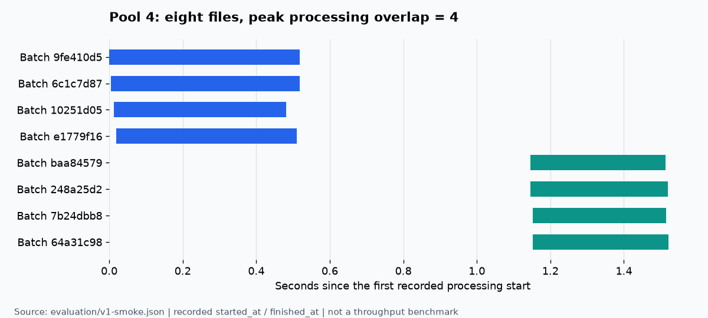

# Commerce ETL v1 — Airflow로 주문 파일을 병렬 처리하기

> **주문 파일 8개를 병렬로 처리하고, 같은 40,000건을 다시 실행해도 주문이 추가되지 않는지 확인했다.** v1에서는 처리 속도 개선보다 병렬 실행과 저장 결과의 정확성을 먼저 검증했다.

의료영상 ETL을 개발하면서 다룬 문제 중 하나는 서로 다른 입력을 공통 형식으로 바꾸고, 재실행해도 결과가 중복되지 않게 하는 것이었다. 이 프로젝트에서는 그 문제를 가상 쇼핑몰의 주문 데이터로 재구성했다. 회사 데이터와 운영 코드를 옮긴 프로젝트가 아니며, 커머스 실무 운영 성과를 주장하는 것도 아니다.

프로젝트의 전체 목표와 버전별 범위는 [v0 — 프로젝트 설계와 진행 방향](v0.md)에 정리했다.

## 결과 먼저 보기

가상 쇼핑몰 두 곳의 주문을 **8파일 × 5,000건 = 40,000건**으로 만들었다. Airflow에서 파일별 태스크를 실행하고, PostgreSQL에 저장한 주문과 표준화한 파일을 대조했다.

| 실행 순서 | Pool 슬롯 | 처리 구간 최대 중첩 | 신규 적재 | 중복 판정 | 검증한 고유 주문 |
| --- | ---: | ---: | ---: | ---: | ---: |
| 1 · 최초 적재 | 4 | 4 | 40,000 | 0 | 40,000 |
| 2 · 같은 입력 재실행 | 1 | 1 | 0 | 40,000 | 40,000 |
| 3 · 같은 입력 재실행 | 2 | 2 | 0 | 40,000 | 40,000 |

세 실행 모두 최종 검증에 성공했고, 검증 대상 주문의 금액 합계는 **439,980,000원**으로 같았다. 실행 기록은 [v1 검증 JSON](../evaluation/v1-smoke.json)에 남겼다.

**이 표는 성능 개선 실험이 아니다.** 최초 적재와 중복 재처리는 DB 작업이 다르고, 각 조건을 한 번씩만 실행했다. 여기서 확인한 것은 설정한 동시 실행 수가 실제 처리에 반영되는지, 재실행 후 주문 내용이 유지되는지다.

## 구현 범위

```text
합성 주문 생성: 쇼핑몰 A CSV 4개 + 쇼핑몰 B JSON 4개
    ↓ 운영자가 DAG 실행
파일 목록 확정·원본 보관
    ↓ Dynamic Task Mapping
    ├─ 파일 1 → 검증·가명화 → 표준 파일 저장 → DB 적재
    ├─ 파일 2 → 검증·가명화 → 표준 파일 저장 → DB 적재
    └─ … 파일 8까지 같은 처리
    ↓ 모든 파일 태스크 종료
실행 결과 집계 → 주문 키·내용·파일 대조 → 성공 또는 실패
```

Python 3.12, Airflow 2.11.0의 LocalExecutor, PostgreSQL 16.9를 Docker Compose로 실행했다. 외부 API 수집이나 정기 실행은 아직 없으며, 생성해 둔 파일을 수동으로 실행하는 배치다. Airflow 메타데이터와 업무용 주문 데이터는 별도 데이터베이스와 역할로 구분했다.

## 1. 왜 Airflow를 사용했나

파일 하나를 읽고 DB에 넣는 작업 자체는 Python으로 구현할 수 있다. 이 프로젝트에서 보여주려는 것은 **여러 파일을 독립적으로 실행하면서 동시 실행 수와 파일별 상태를 관리하는 과정**이다.

예를 들어 파일 A·B·C가 있을 때 A가 끝날 때까지 B를 기다리게 할 필요는 없다. 반면 DB가 감당할 수 있는 양을 넘어 모든 파일을 동시에 실행하는 것도 피해야 한다. 파일별로 작업을 나누고 실행 개수를 제한하기 위해 Airflow를 사용했다.

| 책임 | 담당 |
| --- | --- |
| 입력 파일 수에 따라 태스크 생성 | Dynamic Task Mapping |
| 동시에 실행할 파일 수 제한 | Airflow Pool과 DAG·Executor 설정 |
| 태스크 상태·재시도 이력 | Airflow |
| 입력 검증·개인정보 처리 | Python ETL 코드 |
| 동시 적재의 중복 방지 | PostgreSQL 고유 키와 적재 로직 |

**Airflow의 태스크 성공만으로 데이터가 정확하다고 판단하지 않는다.** DB에 어떤 주문이 저장됐는지 확인하는 검증 단계는 별도로 구현했다.

LocalExecutor는 한 머신에서 여러 프로세스를 실행한다. 이번 구현과 검증도 단일 머신 기준이며, 여러 서버에 작업을 분산하는 구성은 아니다.

## 2. 서로 다른 주문을 공통 형식으로 바꾸기

### CSV와 JSON에 같은 의미의 값이 다른 이름으로 들어온다

아래는 입력 계약을 설명하기 위한 가상 예시다. 실제 실행에 사용한 40,000건은 [생성 스크립트](../scripts/generate_orders.py)로 만들었다.

쇼핑몰 A는 한국 시간의 CSV를 보낸다.

```csv
order_id,customer_id,amount,ordered_at,name,email
A-1001,C-01,29000,2026-01-01 10:00:00,Sample User,sample@example.com
```

쇼핑몰 B는 시간대가 포함된 JSON을 보낸다.

```json
[{"orderNo":"B-2001","buyerId":"U-02","totalPrice":15000,"purchasedAt":"2026-01-01T11:00:00+09:00"}]
```

[transform.py](../src/commerce_etl/transform.py)의 `parse_rows()`가 파일을 읽고, `normalize()`가 공통 모델로 바꾼다. A의 주문은 다음 형태가 된다. `customer_token`은 설명용 값이며 실제 HMAC 계산 결과는 아니다.

```json
{
  "source": "shop_a",
  "order_id": "A-1001",
  "customer_token": "example-token",
  "amount_krw": 29000,
  "ordered_at": "2026-01-01T01:00:00Z"
}
```

금액은 원화 정수로 제한하고 음수·소수·누락된 식별자를 거절한다. A의 시간은 Asia/Seoul로 해석하고, B는 명시된 시간대를 사용한 뒤 UTC로 통일한다. 신규 확정 주문만 다루므로 환불·취소·주문 변경은 초기 범위에 넣지 않았다.

### 고객 정보는 필요한 필드만 남긴다

고객 토큰은 비밀 키와 `(source, customer_id)`를 사용하는 HMAC-SHA256으로 만든다. 같은 키와 입력에서는 같은 토큰을 얻어 재실행 결과를 유지한다. 서로 다른 쇼핑몰의 고객을 같은 사람으로 합치지는 않는다.

이름·이메일·주소는 결과 모델에 포함하지 않는다. 원본에서 필드를 하나씩 삭제하는 대신, 분석에 필요한 다섯 필드만 새 객체로 구성했다. 합성 원본은 별도로 보관하므로 **개인정보 제외 범위는 분석 결과이며, 원본까지 제거하거나 완전한 익명성을 보장하는 것은 아니다.**

## 3. 파일 수만큼 태스크를 만들고 병렬도를 제한하기

### 먼저 이번 실행의 입력을 고정한다

[파이프라인](../src/commerce_etl/pipeline.py)의 `discover()`는 입력 파일의 해시를 계산하고 원본 사본과 `manifest.json`을 남긴다. 태스크에는 이 사본의 경로를 전달하고, 처리 시 해시가 같은지 다시 검사한다.

```text
input/demo/shop_a/part-000.csv
    ↓ 원본 해시 계산·사본 저장
raw/shop_a/<input_hash>.csv
    ↓ 실행별 manifest에 등록
batch_id + source + raw_path + input_hash
    ↓ mapped task에 전달
```

배치 ID에는 입력 해시·쇼핑몰·변환 버전·토큰 키의 지문을 반영한다. 같은 입력과 설정으로 다시 실행하면 같은 표준 파일 경로를 사용한다. 원본 주문 전체를 XCom에 넣지 않고 경로·해시·배치 ID 같은 작은 메타데이터만 전달한다.

### 한 주문이 아니라 한 파일을 태스크 단위로 선택했다

40,000건을 주문별 태스크로 만들면 스케줄러가 관리할 작업도 40,000개가 된다. v1에서는 파일 하나를 작업 단위로 삼아 **8개의 mapped task**로 처리했다. 파일 단위로 상태를 추적하고, 이후 특정 파일만 재처리할 수 있는 경계를 만든 것이다.

[DAG 정의](../dags/orders_etl.py)의 연결 부분은 다음과 같다.

```python
batches = discover_batches()
mapped = process_batch.expand(batch=batches)
finish = finalize_run()
batches >> finish
mapped >> finish
```

`discover_batches()`가 반환한 파일 목록에 맞춰 `process_batch`가 생성된다. 파일마다 함수나 DAG를 추가할 필요는 없다.

각 mapped task는 `orders_pool`의 슬롯 하나를 사용한다. Pool 슬롯을 1·2·4로 바꾸되, DAG와 mapped task의 동시 실행 제한은 4, Executor parallelism은 8로 설정했다. 다른 제한 때문에 Pool 설정보다 적게 실행되는 경우를 피하기 위해서다.

### 설정값 대신 실제 처리 구간을 확인했다



위 그림은 Airflow UI를 재현한 이미지가 아니라, **저장된 실행 기록의 `started_at`·`finished_at`으로 그린 그래프**다. 각 막대는 배치 하나이며, 같은 시간에 네 구간이 겹친 것을 확인할 수 있다.

[실행 도구](../scripts/run_demo.py)는 Airflow 태스크의 실행 구간과 애플리케이션이 기록한 처리 구간의 최대 중첩을 각각 계산한다. 이번에는 두 지표 모두 Pool 4·1·2에서 각각 4·1·2였다. 애플리케이션의 `finished_at`은 DB 트랜잭션 안에서 요약을 작성할 때 기록하므로 태스크 종료나 커밋까지의 전체 시간과는 다르다.

파일 단위 분할에도 한계가 있다. 한 파일만 유난히 크면 그 태스크가 전체 종료를 늦출 수 있고, 현재는 파일 전체를 메모리로 읽는다. v1의 균등한 5,000건 파일에서 동작을 확인했으며 크기 편중·대용량 파일은 추가 검증 대상이다.

## 4. 병렬로 같은 주문이 들어오면 어떻게 처리하나

태스크에서 “DB에 주문이 없다”는 조회 결과만 보고 삽입하면, 다른 태스크도 같은 판단을 할 수 있다. 중복 방지는 최종 저장소에서도 적용해야 한다.

[database.py](../src/commerce_etl/database.py)는 `(source, order_id)`를 기본 키로 사용한다. `shop_a`의 주문 `1001`과 `shop_b`의 주문 `1001`은 서로 다른 주문이다.

```text
주문 키로 INSERT … ON CONFLICT DO NOTHING
    ├─ 신규 키 → inserted
    └─ 기존 키 → 실제 저장된 내용과 비교
                    ├─ 같은 내용 → duplicate
                    └─ 다른 내용 → conflict, 기존 주문 유지
```

기존 키라면 단순히 성공으로 건너뛰지 않고 payload까지 비교한다. 주문 변경은 초기 범위 밖이므로 같은 키의 다른 금액을 최신 값으로 덮어쓰지 않는다. 서로 다른 배치가 여러 키를 삽입할 때는 키 순서를 정렬해 일관된 순서로 접근한다.

이를 확인하기 위해 **파일 네 개에 동일 주문 한 건과 파일별 고유 주문 한 건씩** 넣고 동시에 처리하는 PostgreSQL 통합 테스트를 작성했다.

| 입력 | 기대·검증 결과 |
| --- | --- |
| 총 8행: 공통 주문 4회 + 고유 주문 4건 | 고유 주문 5건, 신규 5건, 중복 3건 |
| 이미 적재한 주문의 금액을 바꿔 재입력 | 기존 금액 유지, 충돌 기록, 최종 검증 실패 |

이 테스트의 동시 호출은 Python 스레드로 수행했다. 앞의 40,000건 Airflow 실행과는 별개의 검증이다. 구현과 assertion은 [test_pipeline.py](../tests/test_pipeline.py)에 있다.

## 5. 적재가 끝났다는 것을 무엇으로 판단했나

### 최종 주문과 처리 이력을 분리했다

| 테이블 | 저장하는 내용 | 구분하는 이유 |
| --- | --- | --- |
| `orders` | 주문 키와 표준 payload | 최종 고유 주문 유지 |
| `batch_runs` | 실행·파일별 상태와 집계 | 어떤 실행의 어느 파일이 끝났는지 확인 |
| `batch_rows` | 실행·파일·행별 판정 | 신규·중복·입력 오류·내용 충돌을 추적 |

같은 주문 40,000건을 재실행하면 `orders`는 유지되고 새 실행의 처리 이력에는 중복 40,000건이 남는다. 재처리를 아무 일도 없었던 것처럼 생략하지 않고 어떤 판정을 내렸는지 기록한다.

표준 JSONL은 DB에 들어간 신규 주문만 담는 파일이 아니다. **값 검증을 통과한 주문 후보**이므로 중복이나 내용 충돌 후보도 포함될 수 있다. 실제 적재 판정은 `batch_rows`와 함께 봐야 한다.

### 건수뿐 아니라 주문 내용과 파일도 대조했다

`finalize()`는 다음 순서로 확인한다.

```text
이번 manifest의 모든 배치가 성공했는지 확인
    ↓
DB와 로컬 배치 요약 대조 → 행 수·판정별 건수 대조
    ↓
표준 파일 해시·내용을 batch_rows의 payload와 대조
    ↓
신규·중복으로 승인된 주문 키의 DB payload 대조
    ↓
report.json 저장 → 오류가 있으면 최종 태스크 실패
```

첫 실제 실행의 보고서에서 발췌한 값이다.

```json
{
  "status": "success",
  "counts": {"inserted": 40000, "duplicate": 0, "conflict": 0, "invalid": 0},
  "unique_orders": 40000,
  "amount_krw": 439980000,
  "errors": []
}
```

검증 범위는 **이번 실행에서 처리한 배치와 승인된 주문**이다. DB 전체의 무관한 주문이나 모든 고아 파일까지 검사한 결과는 아니다. 또 원본을 독립적으로 다시 변환하는 검증기가 아니라 처리 이력과 저장 결과를 대조하므로, 변환 규칙 자체의 정확성은 별도 단위 테스트로 확인한다.

### 리포트를 만들었다고 DAG가 성공하면 안 된다

파일 태스크가 실패해도 리포트는 필요하므로 `finalize_run`에는 `all_done`을 적용했다. 다만 상류 태스크 실패·미완료를 확인해 검증 오류로 전달하고, 오류가 있으면 마지막 태스크도 예외를 발생시킨다.

태스크가 성공했어도 주문 중 `invalid`나 `conflict`가 있으면 최종 검증은 실패한다. 정상 주문을 적재한 것과 전체 입력을 문제없이 처리한 것을 구분하기 위해서다.

## 6. 확인한 범위와 남은 문제

| 검증 | 확인한 내용 |
| --- | --- |
| 실제 Airflow 실행 | 8파일·40,000주문 적재, Pool 1·2·4의 실제 처리 중첩 |
| 같은 데이터 재실행 | 신규 적재 0건·중복 40,000건, 고유 주문과 금액 유지 |
| PostgreSQL 통합 테스트 | 동시 중복 적재, 내용 충돌, 주문 삭제·파일 변조 탐지 |
| 단위·DAG 구조 테스트 | 입력·시간·금액·개인정보 처리, 입력 목록 고정, DAG 연결 |
| 전체 테스트 | 컨테이너에서 36개 통과 |

테스트가 통과했다고 모든 장애 상황의 복구까지 확인한 것은 아니다. v1에는 자동 재시도 설정이 있지만, 실제 DAG의 특정 파일에 장애를 주입하고 그 태스크만 복구하는 데모는 아직 수행하지 않았다.

특히 **표준 파일 저장과 DB 커밋은 하나의 트랜잭션이 아니다.** 파일 저장 후 DB가 실패하거나 DB 커밋 직후 프로세스가 종료되면 두 저장소의 상태가 잠시 다를 수 있다. 파일 원자적 교체·DB 트랜잭션·중복 방지가 있어도 이 경계의 복구는 별도로 검증해야 한다.

다음 v2에서는 파일 B만 실패시키고 A·C의 성공 결과를 유지한 채 B를 재처리하는 흐름을 확인한다. 이후 성능 실험에서는 같은 초기 DB 상태와 같은 입력으로 Pool 1·2·4를 반복 측정한다. 동시 실행 수가 늘어도 DB 경합이나 스케줄링 비용으로 빨라지지 않는다면 그 원인을 기록할 계획이다.

코드를 따라 읽거나 직접 실행하려면 [실행·코드 안내](usage.md)를, 후속 작업 범위는 [전체 계획](../PLAN.md)을 참고하면 된다.
